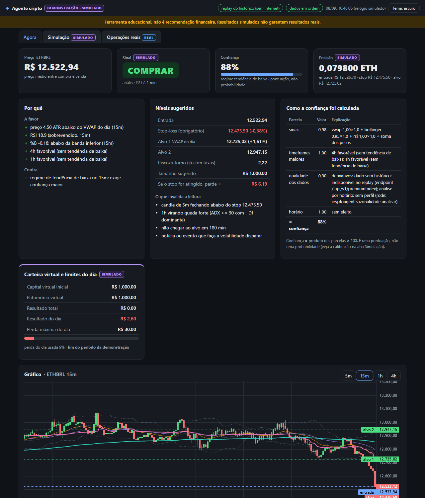
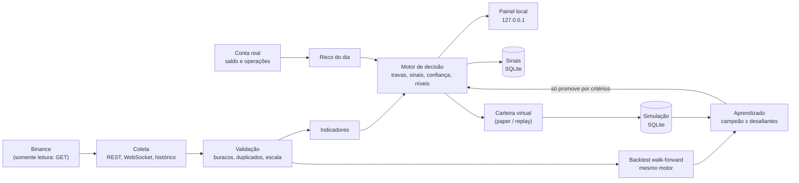

# Agente de decisão cripto (ETH em R$, somente leitura)

Assistente que acompanha o ETH na Binance e diz, a cada 5 minutos, **COMPRAR, VENDER (sair da posição) ou ESPERAR**, com os motivos, uma confiança calculada às claras, os níveis de entrada, stop e alvo, e tudo o que invalidaria a leitura. **Ele nunca envia ordens:** só lê dados, gera sinais e simula com dinheiro virtual. Quem decide e executa é você.

> **Ferramenta educacional, não é recomendação financeira. Resultados simulados não garantem resultados reais.**



<sub>Painel no modo demonstração (dados de exemplo do repositório, carteira virtual). Outras capturas: [claro](docs/img/painel-claro.png), [aba Simulação](docs/img/painel-simulacao.png), [tela estreita](docs/img/painel-estreito.png).</sub>

**English summary at the end of this file.**

---

## Sumário

- [O problema](#o-problema)
- [O que o projeto faz](#o-que-o-projeto-faz)
- [Resultados reais](#resultados-reais)
- [Arquitetura](#arquitetura)
- [Tecnologias](#tecnologias)
- [Instalação e modo demonstração](#instalação-e-modo-demonstração)
- [Uso com a sua conta (somente leitura)](#uso-com-a-sua-conta-somente-leitura)
- [Como o agente decide](#como-o-agente-decide)
- [Segurança](#segurança)
- [Qualidade: testes, lint e CI](#qualidade-testes-lint-e-ci)
- [Limitações](#limitações)
- [Próximos passos](#próximos-passos)
- [Estrutura do projeto](#estrutura-do-projeto)
- [English summary](#english-summary)

## O problema

Operar intraday por conta própria mistura três dificuldades: ler vários indicadores ao mesmo tempo, não comprar no meio de uma queda e, principalmente, saber se uma regra que "parece funcionar" sobrevive às taxas, ao spread e ao tempo. Este projeto trata a terceira parte com o mesmo cuidado das duas primeiras: cada sinal é registrado e comparado com o que o mercado fez depois, toda estratégia passa por backtest com custos e validação walk-forward, e a carteira virtual roda o mesmo código do modo ao vivo.

**A resposta honesta, até agora, é que a estratégia não tem vantagem comprovada** (veja [Resultados reais](#resultados-reais)). O projeto mostra isso em vez de esconder, e tem travas que impedem a estratégia de se passar por validada.

## O que o projeto faz

- **Coleta (somente leitura):** preços e candles por REST e WebSocket, histórico de 13 meses em Parquet (com conferência de buracos, duplicados e preços fora da escala), spread e profundidade do livro medidos ao vivo, saldo e operações da conta.
- **Indicadores:** EMA, RSI, Stoch RSI, MACD, ATR, Bandas de Bollinger, ADX, VWAP do dia, pivôs, suportes e resistências, regime de mercado.
- **Motor de decisão:** reversão à média intraday, só spot (VENDER = sair da posição; nada de venda a descoberto). Travas de segurança, de custo e de estratégia; confiança = produto de parcelas, cada uma explicada.
- **Backtest:** o mesmo motor do modo ao vivo, só com candles já fechados, execução minuto a minuto no par real, taxas, spread por hora e slippage; walk-forward por mês, ablação dos sinais, comparação com comprar e segurar; proveniência gravada (commit, parâmetros, hash dos dados).
- **Carteira virtual (paper trading) em R$:** capital e perda máxima do dia em reais, regras de tamanho mínimo da Binance, atraso de execução, OCO virtual; também em **replay** do histórico com o relógio acelerado.
- **Aprendizado contínuo:** campeão (regras) x desafiantes (variações e um modelo de regressão logística), avaliados no mesmo período, só com dados do passado; promoção só por critérios declarados; alerta de mudança de regime (drift); panoramas de "o que costuma acontecer em momentos parecidos" com intervalo de confiança.
- **Risco:** sessão do dia (capital e perda máxima), bloqueio de compras ao atingir a perda máxima (sair continua permitido), posição conferida com o saldo real.
- **Painel local:** abas Agora, Simulação e Operações reais, tema claro/escuro, rótulos **REAL** x **SIMULADO**, gráfico de candles com os sinais marcados, alertas.
- **Modo demonstração:** roda sem internet e sem chave, com uma amostra pública de candles do ETH/BRL (jun–out/2026) que vem no repositório.

## Resultados reais

Todos os números abaixo vêm de execuções reais do programa, em 11/11/2026, no código desta versão. Nada foi ajustado para ficar bonito.

### Backtest (ETHBRL, fora da amostra: 01/05 a 30/09/2026)

Histórico desde 01/09/2025; custos congelados num arquivo para o resultado ser reproduzível (taxa de 0,1% por lado, spread medido por hora, slippage de 0,01% a mercado e 0,05% no stop; custo médio de ida e volta: 0,26%).

| Variante | Operações | Retorno | Acerto | Drawdown máx. | Média por operação (IC 95%) |
|---|---|---|---|---|---|
| Regras com parâmetros padrão | 13 | **−3,67%** | 23,1% | −4,45% | −0,28% (−0,63% a +0,07%) |
| Walk-forward (parâmetros escolhidos só no treino) | 0 | 0,00% | — | — | — |
| Versão ingênua (compra na banda inferior, sem filtros) | 598 | −76,40% | — | −76,85% | −0,24% |
| Comprar e segurar (mesmos custos) | — | **+24,02%** | — | −33,80% | — |

- **Walk-forward:** em nenhum dos 5 meses alguma combinação de parâmetros ganhou dinheiro no treino (a melhor média foi de −0,32% a −0,41% por operação). A regra é não operar nesses meses, então o resultado é zero operações. Antes desta revisão, o programa escolhia a combinação "menos ruim" e perdia 4,21%.
- **Por que perde:** dos 7.267 sinais técnicos do período, só 37,9% tinham o alvo acima do custo de ida e volta; a mediana do alvo foi 0,72× o custo. No 15m, a volta à média costuma ser menor que as taxas.
- **Ablação:** nenhum dos sinais extras deixou a estratégia positiva (o melhor, Stoch RSI, deu 8 operações e −0,48%). Sem o filtro de horário: 14 operações, −4,41%.
- **Vazamento conhecido:** a tabela de spread por hora foi medida em out–nov/2026 e é aplicada a mai–set. Com o spread padrão do config, o resultado é parecido (12 operações, −3,21%).

### Modelo desafiador (regressão logística)

1.033 momentos candidatos no ETHBRL, 32,1% lucrativos depois dos custos. Fora da amostra: **AUC 0,486** (um sorteio dá 0,5) e Brier 0,256 (pior que a referência de 0,224); no simulador, 30 operações e −3,68%. **O modelo não supera as regras** e continua só como desafiante.

### Aprendizado contínuo (6 ciclos no histórico real, cada um só com o passado)

Nenhuma promoção: os desafiantes foram rejeitados nos 6 ciclos, com os motivos registrados. A confiança das regras **não** acompanha o acerto (faixas 0–40%: 32% de acerto; 40–55%: 33%; 55–70%: 34%; 70–85%: 20%; 85–100%: 30%). Por isso o painel trata a confiança como pontuação, não como probabilidade, e mostra o aviso "estratégia em teste".

### Simulação (carteira virtual em replay, mesmo código do modo ao vivo)

| Período | Replay (carteira virtual) | Backtest no mesmo período |
|---|---|---|
| Amostra do demo, 08/09/2026 | 2 operações, +0,95% | 3 operações, +0,47% |
| Histórico real, 01 a 07/09/2026 (2.016 decisões) | 0 operações, 0,00% | 1 operação, −0,71% |

No mesmo período de 7 dias, comprar e segurar deu +0,24%. A diferença entre replay e backtest vem de dois avisos que só existem no replay (derivativos e perfil por horário indisponíveis, −5% de confiança cada). Com essa penalidade zerada, o replay faz a mesma operação do backtest (mesmo minuto, mesma saída). Duas operações não permitem conclusão nenhuma; o relatório só considera o resultado depois de 30 operações.

### Engenharia

- Backtest completo: **250 s → 67 s**; `cryptoagent --help`: 1,26 s → 0,27 s.
- 381 testes automáticos; cobertura de 79% do pacote e de 89,9% a 98,8% nas partes críticas ([detalhes](docs/COBERTURA.md)).
- Auditoria de "olhar o futuro" no backtest: [docs/AUDITORIA_BACKTEST.md](docs/AUDITORIA_BACKTEST.md).

## Arquitetura



Os sinais são calculados no par de análise (ETHUSDT, mais líquido) e os preços traduzidos para o par em que você opera (ETHBRL).

## Tecnologias

Python 3.11+ · pandas, NumPy, PyArrow (Parquet) · httpx e websockets (cliente Binance assíncrono) · pydantic (configuração validada) · scikit-learn (modelo desafiador, salvo em JSON) · FastAPI + uvicorn (painel local) · HTML/CSS/JS sem build + lightweight-charts (servida localmente) · SQLite · rich (terminal) · pytest, pytest-cov, ruff, pre-commit, GitHub Actions.

## Instalação e modo demonstração

Requisitos: **Python 3.11 ou mais novo** e **git**. Testado no Windows 11 com Python 3.14; o CI está configurado para rodar também no Ubuntu.

**1. Baixe e instale** (Windows, PowerShell):

```powershell
git clone https://github.com/BrenoBorgesss/<nome-do-repositorio>.git
cd <nome-do-repositorio>
python -m venv .venv
.\.venv\Scripts\python.exe -m pip install -e ".[dev]"
```

No Linux ou macOS, troque as duas últimas linhas por:

```bash
python3 -m venv .venv
.venv/bin/python -m pip install -e ".[dev]"
```

Para instalar exatamente as versões com que o projeto foi testado: `pip install -r requirements.txt -r requirements-dev.txt` e depois `pip install -e . --no-deps`.

Nos exemplos abaixo, `cryptoagent` é `.\.venv\Scripts\cryptoagent.exe` no Windows e `.venv/bin/cryptoagent` no Linux/macOS. Rode sempre de dentro da pasta do projeto.

**2. Experimente sem chave e sem internet** (modo demonstração, com a amostra de candles do repositório):

```powershell
.\.venv\Scripts\cryptoagent.exe --demo backtest --rapido
.\.venv\Scripts\cryptoagent.exe --demo paper replay --inicio 2026-09-08 --dias 1
.\.venv\Scripts\cryptoagent.exe --demo painel
```

| Comando (com `--demo`) | O que mostra |
|---|---|
| `backtest --rapido` | Backtest da estratégia na amostra, com custos e comparação com comprar e segurar |
| `paper replay --inicio 2026-09-08 --dias 1` | Carteira virtual rodando sobre um dia do histórico, com o relógio acelerado |
| `painel` | O painel completo repetindo o histórico (abre no navegador; Ctrl+C para sair) |
| `modelo treinar` | Treina o modelo desafiador e compara com as regras |
| `aprendizado reavaliar` / `versoes` / `panorama` | Ciclo campeão x desafiantes, versões e panoramas |
| `historico verificar` / `indicadores validar` | Qualidade dos dados e conferência dos indicadores |

O modo demonstração não lê o `.env`, não usa a internet e grava só em `data/demo/`.

**3. Rode os testes:**

```powershell
.\.venv\Scripts\python.exe -m pytest              # suíte completa (~2-3 min)
.\.venv\Scripts\python.exe -m pytest -m "not lento"  # sem o replay de ponta a ponta
```

## Uso com a sua conta (somente leitura)

1. **Crie uma chave na Binance só com "Habilitar leitura"** (sem trading, saque ou transferência). Recomendado: restringir ao seu IP público. Se a chave tiver qualquer outra permissão, o agente se recusa a rodar; confira com `cryptoagent conta permissoes`.
2. **Copie `.env.example` para `.env`** e preencha `BINANCE_API_KEY` e `BINANCE_API_SECRET`. O `.env` está no `.gitignore`; nunca compartilhe nem cole as chaves em chats.
3. **Baixe o histórico:** `cryptoagent historico baixar` e depois `cryptoagent sazonalidade analisar`.
4. **Abra os processos** (cada um na sua janela; no Windows, `atalhos/iniciar_agente.ps1` faz isso):
   - `cryptoagent custos coletar`: mede spread e profundidade ao vivo;
   - `cryptoagent paper rodar --capital 1000 --perda-max 30`: carteira virtual em R$;
   - `cryptoagent painel`: abre `http://127.0.0.1:8765`.
5. **No painel, responda as perguntas do dia** (capital e perda máxima). Sem isso, o agente fica em ESPERAR.
6. **Se comprar na corretora, coloque o stop (ou OCO) na Binance logo em seguida.** O agente não envia ordens.

Configuração: tudo é ajustável em `config/config.yaml` (cada campo comentado; um campo digitado errado gera erro ao iniciar). Para testar uma hipótese sem mexer no arquivo principal: `cryptoagent --sobrepor minha_hipotese.yaml backtest`.

<details>
<summary><b>Todos os comandos</b></summary>

| Grupo | Comando | O que faz |
|---|---|---|
| Dados | `dados status` / `dados ao-vivo --segundos 60` | Foto dos dados agora; preço e candles pelo WebSocket |
| Histórico | `historico baixar` / `historico verificar` | Baixa 13 meses de candles (Parquet) e mostra buracos e problemas |
| Custos | `custos coletar` / `custos resumo` | Coleta spread, profundidade e slippage ao vivo e resume |
| Sessão | `sessao iniciar` / `sessao ver` | Perguntas do dia (capital e perda máxima) |
| Conta | `conta permissoes` / `conta status` | Confere se a chave é só leitura; saldo, taxas, resultado do dia, limites |
| Diário | `diario adicionar/listar/remover` | Registro manual de operações (contingência sem chave) |
| Indicadores | `indicadores ver --tf 15m` / `indicadores validar` | Valores ao vivo e validação no histórico |
| Horário | `sazonalidade analisar` / `sazonalidade agora` | Mapa de calor por hora e comparação de agora com o histórico |
| Decisão | `analisar` | COMPRAR/VENDER/ESPERAR agora, com tudo explicado |
| Sinais | `sinais listar` / `sinais associar` | Histórico de sinais e ligação com as suas compras |
| Backtest | `backtest` (`--pares`, `--rapido`, `--custos-arquivo`) | Walk-forward, ablação, comparações; relatório HTML e JSON |
| Modelo | `modelo treinar` | Modelo desafiador avaliado contra as regras |
| Aprendizado | `aprendizado reavaliar` / `versoes` / `panorama` | Campeão x desafiantes, versões, panoramas e calibração |
| Paper | `paper rodar` / `relatorio` / `replay` / `resetar` | Carteira virtual ao vivo, relatório, replay do histórico e recomeço |
| Painel | `painel` (`--porta`, `--sem-navegador`) | Painel local e alertas |
| Alertas | `alertas testar` | Alerta de teste no terminal e no Windows |

</details>

## Como o agente decide

Reversão à média intraday, só spot. Decisão a cada candle de 5 minutos fechado.

1. **Travas de segurança** (qualquer uma leva a ESPERAR, com o motivo escrito): dados frescos e completos, relógio certo, sessão do dia respondida, saldo lido, spread abaixo do limite, perda máxima do dia não atingida. Com a perda máxima atingida e posição aberta, só aparece VENDER em stop, invalidação ou tempo.
2. **Travas de estratégia:** regime do 15m diferente de alta volatilidade; sem queda forte no 1h nem queda sustentada no 4h; **gatilho anti-faca** (o preço esticou abaixo da banda e voltou para dentro, subindo).
3. **Travas de custo:** alvo a pelo menos 2,5× o custo de ida e volta e risco/retorno de pelo menos 1 depois das taxas.
4. **Sinais (conjunto mínimo):** distância abaixo do VWAP do dia, %B das Bandas de Bollinger e RSI, cada um com nota de 0 a 1. Os extras ficam desligados porque a ablação não mostrou ganho.
5. **Confiança** = nota dos sinais × confirmação do 1h/4h × qualidade dos dados × fator do horário (× fator do cenário). É uma pontuação, não uma probabilidade. O mínimo depende do regime.
6. **Níveis:** stop obrigatório abaixo do fundo recente; alvo 1 na média (VWAP ou meio das bandas); alvo 2 na banda superior; tamanho calculado para que, no stop, a perda seja o risco por operação.
7. **VENDER (com posição):** stop, alvo, preço esticado para cima, leitura invalidada ou tempo máximo sem chegar ao alvo.
8. **Confiabilidade:** COMPRAR só vale como compra firme se o último backtest do par (fora da amostra, com custos, de até 45 dias) tiver pelo menos 30 operações, média positiva, fator de lucro acima de 1 e o intervalo de 95% da média todo acima de zero. Senão, aparece "AGUARDAR (estratégia em teste)", que é o caso hoje.

## Segurança

- **Só leitura:** o cliente da Binance só faz GET, numa lista fixa de endpoints de leitura. Testes varrem o código procurando chamadas de ordem, saque ou transferência.
- **Não existe código de execução real.** Não há função, flag nem configuração que envie ordem. Se um dia isso for acrescentado, a regra do projeto é ficar desligado por padrão, atrás de uma flag explícita e com aviso claro.
- **Carteira virtual separada:** a simulação usa um banco próprio e nunca usa o saldo real para operar.
- **Chave verificada:** as permissões são conferidas ao iniciar e a cada hora; com qualquer permissão além de leitura, o agente para.
- **Segredos:** as chaves só vêm do `.env`. Logs, erros e o painel passam por um filtro que mascara chaves e assinaturas. O pre-commit recusa `.env`, bancos SQLite, `data/`, `logs/` e chaves privadas.
- **Painel:** escuta só em `127.0.0.1`, recusa `Host` diferente de `127.0.0.1`/`localhost` (proteção contra DNS rebinding) e exige um token para qualquer alteração.
- **Dado velho, ausente ou inconsistente = ESPERAR**, sem presumir valores.

## Qualidade: testes, lint e CI

- **381 testes** (pytest): coleta, indicadores, sinais, decisão, backtest (sem olhar o futuro, atalhos exatos, custos, walk-forward), carteira virtual, registro de operações, promoção de modelo, risco e segurança. Respostas da Binance são simuladas; nenhum teste usa a rede.
- **Cobertura:** `python -m pytest --cov --cov-report=json:coverage.json` e `python scripts/cobertura_critica.py coverage.json --minimo 85` ([relatório](docs/COBERTURA.md)).
- **Lint e formatação:** `ruff check .` e `ruff format --check .`; `pre-commit install` liga as checagens antes de cada commit.
- **CI:** `.github/workflows/ci.yml` roda lint e testes no Ubuntu (Python 3.11 e 3.14) e no Windows (3.14), com cobertura mínima de 85% por área crítica.

## Limitações

- **A estratégia perde depois dos custos** no período testado, e o walk-forward não encontrou parâmetros que ganhassem no treino.
- **Amostra pequena:** 13 operações no backtest fora da amostra; o intervalo de 95% da média cruza o zero.
- **Order book sem histórico:** o sinal do livro de ofertas só pode ser avaliado ao vivo.
- **Spread por hora** medido em poucas semanas e aplicado ao passado (efeito medido acima).
- **Um ativo, um mercado:** ETH em BRL/USDT na Binance, spot.
- **Testado só no Windows:** os alertas nativos e os atalhos são do Windows; o restante não depende do sistema, mas Linux e Python 3.11 só serão conferidos quando o CI rodar no GitHub.

## Próximos passos

- Acumular pelo menos 30 operações virtuais no paper trading ao vivo antes de qualquer conclusão.
- Testar a hipótese de timeframe maior (1h), onde os movimentos superam as taxas com mais folga; a hipótese já está registrada em `config/hipotese_setup_1h.yaml`.
- Coletar o livro de ofertas por mais tempo para avaliar o sinal de desequilíbrio.
- Calibrar a confiança (ex.: regressão isotônica) só quando houver dados suficientes.

## Estrutura do projeto

```
config/            config.yaml (tudo ajustável), demo.yaml e hipóteses
src/cryptoagent/
  data/            REST e WebSocket somente leitura, histórico, validação, saúde dos dados
  indicators/      indicadores técnicos e regime
  engine/          sinais, travas, níveis, decisão, análise ao vivo, registro
  backtest/        simulador, execução, métricas, walk-forward, relatório, proveniência
  model/           modelo desafiador (regressão logística)
  learning/        campeão x desafiantes, drift, panoramas, versões
  paper/           carteira virtual, replay e relatório
  account/         permissões, saldo, operações, resultado do dia, limites, diário manual
  session/         perguntas do início do dia
  costs/           coletor de custos, slippage, custo de ida e volta
  seasonality/     análise por horário
  dashboard/       serviço, servidor local e página
  alerts/          alertas (terminal, Windows, painel)
exemplos/          amostra pública de candles para o modo demonstração
docs/              auditoria do backtest, cobertura, capturas de tela
tests/             testes automáticos
scripts/           medição de desempenho, cobertura, geração da amostra
```

Histórico da revisão: [PROGRESSO.md](PROGRESSO.md) (checklist com evidências de cada etapa) e [DIAGNOSTICO.md](DIAGNOSTICO.md).

## Licença

[MIT](LICENSE). A biblioteca de gráficos lightweight-charts é distribuída sob a licença Apache 2.0 ([licença](src/cryptoagent/dashboard/static/vendor/LICENSE-lightweight-charts.txt)).

---

## English summary

**Read-only decision assistant for ETH on Binance (BRL market).** Every 5 minutes it outputs **BUY, SELL (exit) or WAIT** with reasons, a transparent confidence score, entry/stop/target levels and invalidation conditions. **It never sends orders**: it only reads market and account data, generates signals and simulates with virtual money.

- **Strategy:** intraday mean reversion, spot only, with safety, cost and strategy gates and an anti-falling-knife trigger.
- **Validation:** the same decision engine runs live, in the backtest (closed candles only, minute-level execution with fees, spread and slippage, monthly walk-forward, ablation) and in paper trading (including accelerated replay of history).
- **Continuous learning:** champion (rules) vs challengers (variants and a logistic regression model), point-in-time evaluation, declared promotion criteria, drift alerts.
- **Honest results (11/11/2026, ETHBRL, out-of-sample May–Sep 2026):** default rules −3.67% over 13 trades vs buy-and-hold +24.02%; walk-forward found no parameter set profitable in training, so it did not trade; the ML challenger reached AUC 0.486. **The strategy has no proven edge**, and the project says so.
- **Engineering:** Python 3.11+, pandas, FastAPI dashboard bound to localhost with token and Host checks, 381 tests (79% coverage, 89.9–98.8% on critical areas), ruff, pre-commit, GitHub Actions.
- **Try it offline:** `pip install -e ".[dev]"`, then `cryptoagent --demo backtest --rapido` or `cryptoagent --demo painel` (no API key, no network).

> Educational tool, not financial advice. Simulated results do not guarantee real results.
